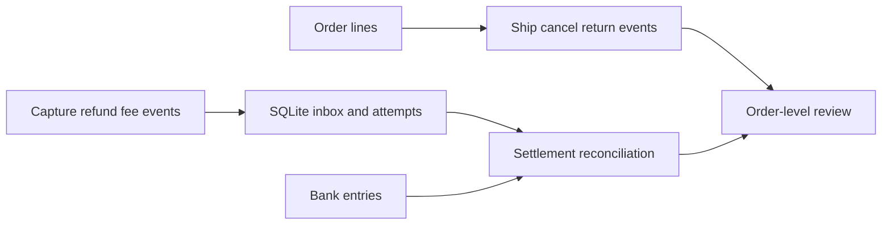

# E-Commerce Order and Payment Reconciliation Lab

An **AI-assisted, synthetic-data learning project**, connecting order-line fulfillment with payment settlement. No employer data, live payments or deployment.

## Business question

Can a bank settlement match while an order still needs refund review? Yes: shipping, cancellation, physical returns, payment refunds and settlement are different events. This project preserves their references and checks separate identities.

## Reproduce

Python 3.10+, standard library only. From this directory:

```text
python -m unittest -v
python demo_flow.py
```

[Worked result](results/RESULTS.md) · [Source-linked JSON](results/demo.json) · [Local test evidence](results/validation.json)

## Implemented

| Module | Rule and evidence |
|---|---|
| `reconcile.py` | Integer HKD cents; capture minus refund minus fee; cumulative refund limit; cutoff; pending/matched/mismatch/blocked states |
| `fulfillment.py` | Order lines, split shipments, cancel unshipped units, returns linked to shipments; ordered = shipped + cancelled + unfulfilled |
| `event_store.py` | SQLite inbox and attempt history; retries across restarts preserve one unique event; conflicting payloads are quarantined |
| `demo_flow.py` | Joins validated payments to orders; a matched HKD 77 settlement coexists with a refund-review flag |
| `test_*.py` | Hand calculations, duplicates/conflicts, cumulative limits, cutoff, invalid dates, returns and SQLite restart checks |



## Boundaries

- Synthetic HKD events only; no FX, live provider API, authentication, encryption, blockchain, chargebacks or revenue recognition.
- Dates have day resolution; same-day logistics events follow input sequence. Business date is not arrival time; this is not bitemporal late-arrival replay.
- Invalid envelopes may raise exceptions: this is not an untrusted public API. Total captures are not capped to original order value.
- Refunds can differ from physical returns. Review flags are not contractual refund instructions. Tax, promotions and shipping charges are not modeled.
- Logistics rejection is recorded and order review marks incomplete logistics; partial data cannot establish completeness.
- `order_cash_review` expects validated, deduplicated events at the same cutoff. The demo takes these from reconciliation, not raw input.
- SQLite history is append-only through this API, not tamper-proof against direct database access. No operator identities are authenticated.
- Pending means no bank entry by cutoff, not overdue: no settlement SLA is modeled. Fees are explicit events, not inferred provider tariffs.

## Programme relevance

CUHK ECLT: transaction information, payment integrity, reverse logistics and enterprise-system traceability. CityUHK FTDA: reconciliation/control foundations, supplemented by the separate stablecoin risk lab. This is a course-based matching judgment, not a portfolio admission requirement.

See [programme mapping](PROGRAMME_FIT.md) and [contribution boundaries](CONTRIBUTIONS.md).

## References

- https://docs.stripe.com/reports/balance — gross, fee and net concepts.
- https://docs.stripe.com/api/idempotent_requests — retry consistency principle.
- https://docs.stripe.com/refunds — original payment and partial refund concepts.

These informed the educational design; the prototype does not implement Stripe's complete API or rules. All examples are original synthetic data.
